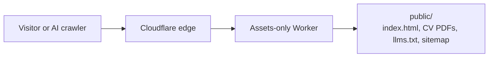

# leonardpliachko.com

Source of my personal portfolio site, **[leonardpliachko.com](https://leonardpliachko.com)**.

I am Leonard Pliachko, a Senior Product Manager in B2B SaaS and enterprise (identity and access, integrations, analytics). This site is a one-page summary of my work, with my CV and a link to a live prototype.

## How it is built

- Static HTML and CSS, no framework, no build step - everything served lives in `public/`.
- Hosted on Cloudflare Workers as an assets-only Worker (`wrangler.jsonc`), apex domain with `www` redirect.
- Self-hosted fonts, `llms.txt`, `sitemap.xml` and `robots.txt`, so both search engines and AI assistants can read it.



## Run locally

```
npx wrangler dev
# or just open public/index.html
```

Built and deployed with Claude Code.
